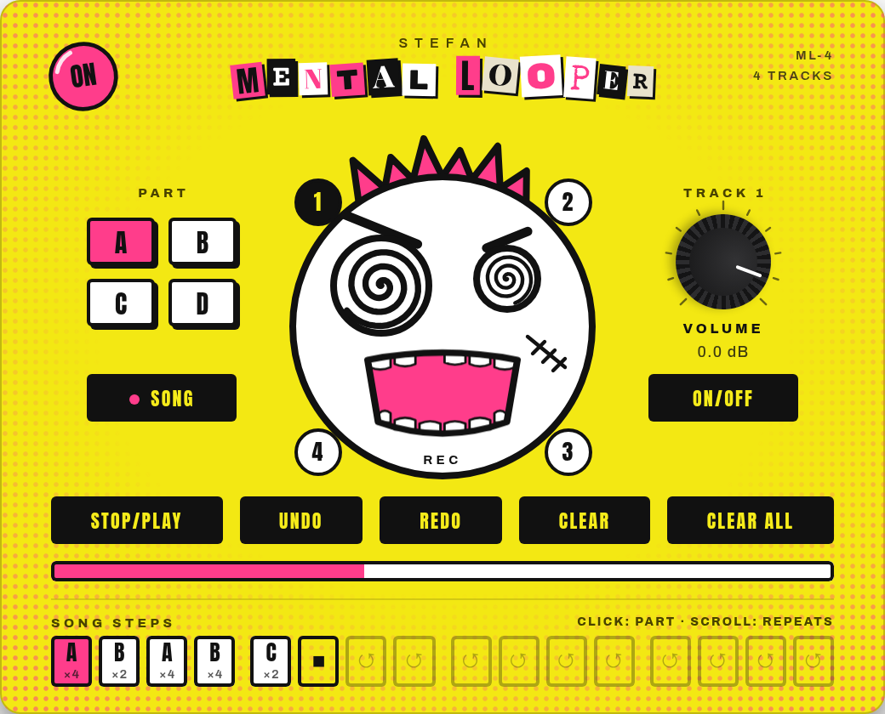

# Mental Looper



**A four-track looper for building songs live, for [MOD Dwarf](https://mod.audio/dwarf/),
[MOD Desktop](https://mod.audio/desktop/) and any LV2 / VST3 / CLAP host.** Play free, and the
first loop you record sets the length for every track, or lock the loops to MOD's tempo with a
click. Record four tracks in each of four parts, arrange the parts into a song, and save the whole
piece to bring it back later. Built with the [DISTRHO Plugin Framework (DPF)](https://github.com/DISTRHO/DPF),
mono in and mono out, plus a click output.

- **Free or in time.** Free by default, with no click and no bars. Set Sync to Bars and loops start on MOD's bar lines, last whole bars and follow MOD's play and stop, with an optional click and a fixed loop length in bars.
- **Parts and a song.** Four parts (A-D) of four tracks each. Switch parts at the end of a pass, or let a 16-step song play them in order, with repeats, Loop and Stop. Double-tap B to go to the next part, keeping the tracks below the selected one and recording it from the first beat.
- **Saved pieces.** Save the whole piece (4 parts, mix, arrangement) to one of 16 slots on the Dwarf and load another between songs. Pieces are plain WAV folders you can copy.
- **Two footswitches.** B records, plays and overdubs; hold it to undo, double-tap it for a new part. C turns the selected track off and on, clears it on a hold, and stops or starts everything on a double-tap. Redo is on a knob.
- Overdub as much as you like and undo one layer at a time. The loop point is click-free.
- Optional auto-record: arm a track and it starts on your first note.
- Tracks can be longer than the first loop: keep playing past the end.
- Per-track volume and on/off. The Dwarf screen shows a progress bar, track states, layer counts,
  the song and the slots (Starless 19 or later).
- A face on MOD's pedalboard that shows what the looper is doing: its eyes turn once per loop and its mouth screams while you record.
- The output is only the loops: wire your dry signal around it, or turn up **Dry**.

**[Install](#install) · [Manual (PDF)](docs/manual/mental-looper-manual.pdf) · [Building](DEVELOPERS.md)**

## Install

**MOD Dwarf, Duo and Duo X: install from the browser.** Connect the unit to your computer
over USB and open **[builder.mod.audio/install/8lrat00e](http://builder.mod.audio/install/8lrat00e)** (v0.2.0). The page installs
the build for your unit. Chrome and Edge ask to access devices on your local network: allow it.

Grab the latest bundle for your device from the
**[Releases page](https://github.com/stefdoerr/mental-looper/releases/latest)**.
Replace `X.Y.Z` below with the version you downloaded. The plugin appears
under brand **Stefan** as **Mental Looper**.

### MOD Dwarf

```bash
tar xf mental-looper-vX.Y.Z-dwarf-aarch64.tar.gz
scp -O -r mental-looper.lv2 root@192.168.51.1:/root/.lv2/
ssh root@192.168.51.1 'systemctl restart jack2 mod-ui'
```

Then hard-refresh the MOD web interface (Ctrl-Shift-R).

### MOD Desktop (Linux)

```bash
tar xf mental-looper-vX.Y.Z-linux-amd64.tar.gz
cp -r mental-looper.lv2 ~/"Documents/MOD Desktop/lv2/"
```

Restart MOD Desktop.

### Desktop DAWs

The release also has VST3 and CLAP builds for Linux, Windows and macOS (macOS unsigned:
right-click, Open). Copy them into your plugin folders, e.g. `~/.vst3/` and `~/.clap/` on Linux.
Rec/Undo and Stop/Clear are press-and-release switches: outside MOD, map them to a momentary
control such as a MIDI footswitch. The Windows build has no saved pieces.

### From source

```bash
git clone --recurse-submodules https://github.com/stefdoerr/mental-looper.git
cd mental-looper
make                # bin/mental-looper.{lv2,vst3,clap}
./install.sh        # copies bin/mental-looper.lv2 into ~/Documents/MOD Desktop/lv2/
make dwarf          # or: cross-build for the Dwarf (needs Docker, see DEVELOPERS.md) and deploy
```

## Manual

The **[PDF manual](docs/manual/mental-looper-manual.pdf)** covers the controls, the
footswitch gestures and the settings. On a MOD device it is the *documentation* button in the
plugin's info dialog.

## Building & contributing

Build targets, the Dwarf cross-build and the DPF patch are in **[DEVELOPERS.md](DEVELOPERS.md)**.
For LLM-assisted work, point your agent at [`INSTRUCTIONS.md`](INSTRUCTIONS.md).

## Acknowledgements

- [DISTRHO Plugin Framework (DPF)](https://github.com/DISTRHO/DPF), the LV2/VST/CLAP framework.
- [MOD Audio](https://mod.audio), for the Dwarf, MOD Desktop and the modgui design.

## License

Plugin code is ISC-licensed. DPF is ISC-licensed (see [`dpf/LICENSE`](dpf/LICENSE)).
