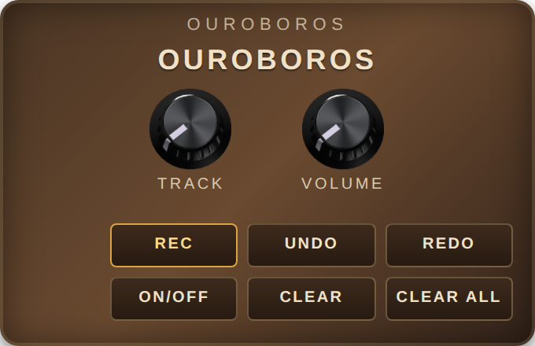

# Ouroboros



**A four-track looper for free-time playing, for [MOD Dwarf](https://mod.audio/dwarf/),
[MOD Desktop](https://mod.audio/desktop/) and any LV2 / VST3 / CLAP host.** No click and no
bars: the first loop you record sets the length, and the other three tracks lock to it. Overdub
as much as you like and undo one layer at a time. Built with the
[DISTRHO Plugin Framework (DPF)](https://github.com/DISTRHO/DPF), mono in and mono out.

- Rec / Play / Dub on one footswitch; undo (tap), redo (hold) and stop (double-tap) on another.
- Optional auto-record: arm a track and it starts on your first note.
- Click-free loop point, punch in/out, undo, redo and clear.
- Tracks can be longer than the first loop: keep playing past the end.
- Per-track volume and on/off. The Dwarf screen shows a progress bar and track states
  (Starless 19 or later).
- The output is only the loops: wire your dry signal around it, or turn on **Dry thru**.

**[Install](#install) · [Manual (PDF)](docs/manual/ouroboros-manual.pdf) · [Building](DEVELOPERS.md)**

## Install

Build from source and copy `ouroboros.lv2` to your host.

### MOD Desktop (Linux)

```bash
git clone --recurse-submodules https://github.com/stefdoerr/ouroboros.git
cd ouroboros
make
./install.sh        # copies bin/ouroboros.lv2 into ~/Documents/MOD Desktop/lv2/
```

Restart MOD Desktop. The plugin appears under brand **Stefan** as **Ouroboros**.

### MOD Dwarf (hardware)

```bash
make dwarf          # cross-build (needs Docker, see DEVELOPERS.md) and deploy
```

or copy a prebuilt `ouroboros.lv2/` over by hand:

```bash
scp -O -r ouroboros.lv2 root@192.168.51.1:/root/.lv2/
ssh root@192.168.51.1 'systemctl restart jack2 mod-ui'
```

### Desktop DAWs

`make` also writes `bin/ouroboros.vst3` and `bin/ouroboros.clap`. Copy them into `~/.vst3/` and
`~/.clap/`.

## Manual

The one-page **[PDF manual](docs/manual/ouroboros-manual.pdf)** covers the controls, the
footswitch gestures and the settings. On a MOD device it is the *documentation* button in the
plugin's info dialog.

## Building & contributing

Build targets, the Dwarf cross-build and the DPF patch are in **[DEVELOPERS.md](DEVELOPERS.md)**.
For LLM-assisted work, point your agent at [`INSTRUCTIONS.md`](INSTRUCTIONS.md).

## Acknowledgements

- [DISTRHO Plugin Framework (DPF)](https://github.com/DISTRHO/DPF), the LV2/VST/CLAP framework.
- [MOD Audio](https://mod.audio), for the Dwarf, MOD Desktop and the modgui design.

## License

Plugin code is ISC-licensed. DPF is ISC-licensed (see [`dpf/LICENSE`](dpf/LICENSE)).
